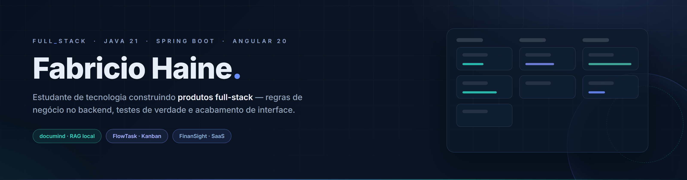

  

  

  [Sobre mim](#-sobre-mim) · [Stack e ferramentas](#-stack-e-ferramentas) · [Projetos](#-projetos-em-destaque) · [Em andamento](#-em-andamento) · [Estatísticas](#-estatísticas) · [Contato](#-vamos-nos-conectar)

---

> **Tela bonita que mente não é produto — é maquete.**
> Meus repositórios existem para provar o contrário: regras no backend, testes de verdade e acabamento de interface.

## 👤 Sobre mim

Sou **Fabricio Haine**, estudante de tecnologia com um interesse que atravessa tudo que eu construo: **resolver problemas reais** — unindo lógica de programação, boas práticas de engenharia e visão de negócio. Gosto de sair do tutorial e chegar no produto: algo que alguém abre, testa, erra e continua usando.

Nos meus projetos, o princípio que me guia é que **a verdade mora no backend**: autorização decidida no servidor (nunca "escondida" no front), histórico com o ator autenticado, indicadores nascidos de consultas — e nenhum dado mockado fazendo cena. O acabamento acompanha esse rigor: estados de carregamento, erro e vazio tratados de verdade, confirmação consciente para ações destrutivas e suítes cobrindo regra e fluxo — unitário, integração e smoke test.

Também cuido do que se vê. Cada projeto tem um **design system autoral em tema dark**: os tokens `--ft-*` do FlowTask, o `Midnight` do FinanSight, o teal do DocuMind — com tipografia Inter, espaçamento consistente e a mesma voz visual de produto em todos os repositórios. Do outro lado da linha, **Python** aparece em estudos, automação e scripts de verificação.

Hoje a base é **Java 21 + Spring Boot** no backend e **Angular 20** no frontend, sobre **PostgreSQL** versionado por **Flyway**. Prefiro profundidade a amplitude: melhor um recurso sólido, testado e honesto do que dez telas de vitrine.

🇺🇸 <b>About me (English)</b>

Hi! I'm **Fabricio Haine**, a technology student building real full-stack products — Java 21 + Spring Boot on the backend, Angular 20 on the frontend, with PostgreSQL versioned by Flyway. My rule of thumb: **the truth lives in the backend** — permissions decided on the server, no mocked data, honest loading/empty/error states, and tests covering both rules and flows. I also care about the product feel: authorial dark design systems built on design tokens, Inter typography and a consistent visual voice across my repositories.

## 🧰 Stack e ferramentas

**Linguagens e base web:**

**Backend e dados:**

**Frontend e qualidade:**

**Ferramentas:**

## 🚀 Projetos em destaque

| Projeto | O que é |
|---|---|
| **[documind](https://github.com/FabricioHaine/documind)** | Plataforma de inteligência de documentos com **RAG 100% local** — busca vetorial real com `pgvector` + índice HNSW, embeddings do `nomic-embed-text` via Ollama e **citações construídas pelo backend** a partir dos trechos efetivamente recuperados. Sem evidência suficiente, a resposta admite que não encontrou. |
| **[flowtask](https://github.com/FabricioHaine/flowtask)** | Gestão de projetos com **quadro Kanban colaborativo** e papéis OWNER/MANAGER/MEMBER decididos no backend (`404`/`403`). Drag & drop com rollback otimista, concorrência protegida por `SELECT … FOR UPDATE` + `@Version` → `409` e exclusão de projeto em cascata transacional, liberada só ao OWNER que **digitar o nome do projeto**. 54 rotas em 11 controllers, 11 tabelas e 72 testes + 42 verificações de fumaça. |
| **[FinanSight](https://github.com/FabricioHaine/FinanSight)** | **SaaS de finanças pessoais** com indicadores calculados no servidor, orçamentos, metas e exportação CSV em pt-BR — sob o design system `Midnight`, um tema dark autoral com tipografia Inter e gráficos Chart.js. |
| **[nexus-crm](https://github.com/FabricioHaine/nexus-crm)** | **CRM** de clientes e oportunidades com funil comercial e papéis ADMIN/GERENTE/VENDEDOR. Sessão por **JWT em cookie HttpOnly + CSRF de dupla submissão com rotação de token**, Docker multi-stage e **CI no GitHub Actions** — 98 verificações entre unidade, integração e fumaça. |

## 🚧 Em andamento

- **CI nos projetos principais** — pipeline no GitHub Actions rodando `mvn test` e `ng test` a cada push (o padrão já vive no nexus-crm; levar aos demais)
- **Docker completo** — Dockerfile da aplicação + `compose` com backend, frontend e banco (hoje o compose cobre só o PostgreSQL)
- **E2E de navegador** — Playwright nos fluxos críticos do Kanban: arrastar cartão, convites e exclusão com confirmação textual
- **E-mail transacional** — SMTP real para convites e notificações, além da recuperação de senha

## 📊 Estatísticas

<picture>
  <source media="(prefers-color-scheme: dark)" srcset="https://github-readme-stats.vercel.app/api?username=FabricioHaine&show_icons=true&hide_border=true&include_all_commits=true&count_private=true&bg_color=080E19&title_color=8293FF&icon_color=A5B4FC&text_color=C9D1D9" />
  
</picture>

<picture>
  <source media="(prefers-color-scheme: dark)" srcset="https://github-readme-stats.vercel.app/api/top-langs?username=FabricioHaine&layout=compact&langs_count=6&hide_border=true&bg_color=080E19&title_color=8293FF&text_color=C9D1D9" />
  
</picture>

  

  

<picture>
  <source media="(prefers-color-scheme: dark)" srcset="https://raw.githubusercontent.com/FabricioHaine/FabricioHaine/output/github-contribution-grid-snake-dark.svg" />
  
</picture>

## 📫 Vamos nos conectar?

  <b>Aberto para conversar sobre backend, produto e engenharia de software.</b>  
  

  
   Do problema real ao produto que não finge funcionar.

